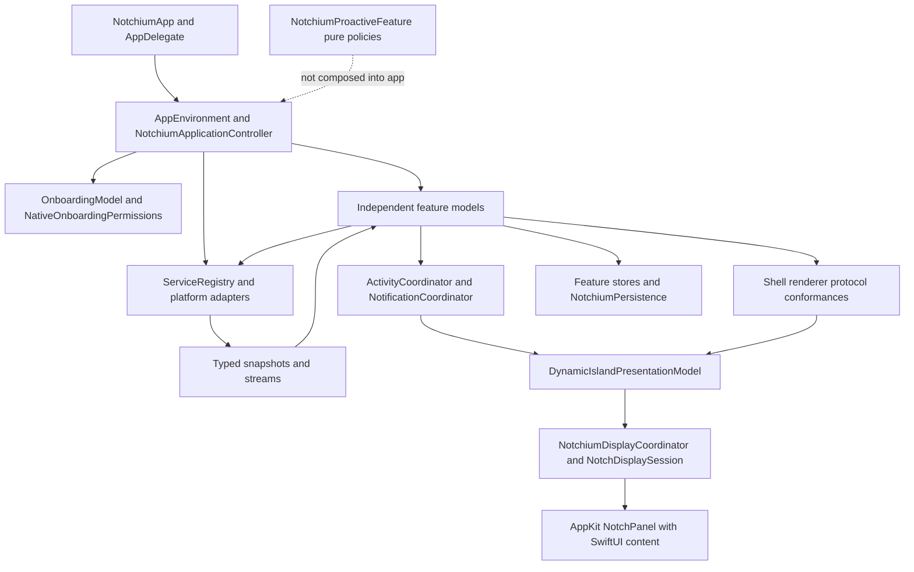

# Current Notchium architecture

Research date: 2026-10-21. Source baseline: `171175e2362e198886d5e7044b5a6315a5dd844d`, plus the existing working tree. This is a source inspection, not a new runtime or release qualification. Existing waveform edits and release-validation documentation were left untouched.

## Evidence and scope

**Confirmed** means inspected source/configuration or an installed SDK declaration. **Documented** means an external vendor documents the capability. **Recommended** means engineering judgment. **Unverified** means a platform, account, packaging, or product assumption still needs a focused experiment. A module, enum case, historical stage report, or `Real` prefix alone does not establish a shipping capability.

Repository rules are in `CLAUDE.md`, `docs/ENGINEERING_RULES.md`, and `docs/PERMISSIONS.md`; no repository `AGENTS.md` file was found during inspection. The instructions supplied in this conversation also apply. Older stage documentation is useful context; current source wins when they disagree. Existing `docs/PROACTIVE_INTELLIGENCE_FEASIBILITY.md` already identifies much of the local proactive foundation; this plan extends that work rather than claiming it is a deployed AI system.

## Application structure and data flow

The app is a macOS 26+ menu-bar agent with a thin SwiftUI entry point. The local Swift package owns almost all functionality. `NotchiumPackage/Package.swift` declares Swift tools 6.2, macOS 26, first-party modules, and no external package dependencies. `Config/Shared.xcconfig` explicitly sets `SWIFT_VERSION = 6.0` and complete strict concurrency. No explicit default actor-isolation or approachable-concurrency setting was found in the inspected manifest/configuration. Do not introduce assumptions based on new-project Xcode defaults.

`NotchiumCore` contains Foundation value types, availability, consent, identity, time, and dependency contracts. `NotchiumServices` contains OS-facing protocols and adapters; `NotchiumPersistence`, `NotchiumDiagnostics`, and `NotchiumDesignSystem` provide shared infrastructure. Feature targets do not import other features' concrete types. `NotchiumDynamicIsland` depends on Core and DesignSystem, not feature implementations. Features supply renderer conformances. `NotchiumFeature` is the composition target; it may assemble features without turning the application controller into an AI business-logic owner.

The intended flow is provider truth → feature state → typed/redacted activity → shared presentation policy → display projection. New AI logic must preserve this direction.

## Verified reuse inventory

All paths in this table are relative to the repository root `/Users/marcusyu/Projects/notch`; symbols are actual existing symbols, not proposed names.

| Concern | Source and symbols | Reuse and actual limit |
|---|---|---|
| App lifecycle | `Notchium/NotchiumApp.swift`: `NotchiumAppDelegate`; `NotchiumPackage/Sources/NotchiumFeature/NotchiumApplicationController.swift`: `production`, `start`, `stop` | Own AI construction/start/stop here. Startup is gated by first-launch setup. Closing the last window does not quit. |
| Dependency injection | `NotchiumPackage/Sources/NotchiumFeature/AppEnvironment.swift`: `AppEnvironment`; `NotchiumPackage/Sources/NotchiumServices/ServiceRegistry.swift`: `ServiceRegistry` | Inject provider, storage, clock, UUID, logger, and mock modes. The registry is a value assembled at the root, not permission to add a global service locator. |
| Notch/display ownership | `NotchiumPackage/Sources/NotchiumDynamicIsland/NotchiumDisplayCoordinator.swift`, `NotchDisplaySession.swift`, `NotchiumPanelController.swift`, `NotchPanel.swift` | Reuse display selection, panel lifetime, sleep/fullscreen behavior, keyboard eligibility, Escape handling. `NotchPanel.canBecomeKey` follows `allowsKeyboardFocus`; passive hover must not acquire typing focus. |
| Fixed UI contract | `NotchiumPackage/Sources/NotchiumDynamicIsland/NotchPanelLayout.swift`: `ExpandedNotchLayout`, `NotchGeometryResolver`; `Pages/NotchPage.swift`, `Pages/NotchPagesView.swift` | 524×266 pt expanded surface in a stable 740×322 pt panel. Six pages: Home, Music, Calendar, Focus Timer, Audio, Shelf; Clipboard is within Shelf. Hidden pages remain mounted but disabled/inaccessible. |
| Activity policy | `NotchiumPackage/Sources/NotchiumDynamicIsland/ActivityCoordinator.swift`, `ActivityPriorityPolicy.swift`, `NotificationCoordinator.swift` | One source of priority/coalescing/expiry with per-display projections. Do not send screenshots, mail bodies, or transcripts through this router. |
| Calendar | `NotchiumPackage/Sources/NotchiumServices/CalendarService.swift`: `CalendarService`, `RealCalendarService`, `CalendarSnapshot`, `CalendarEventSummary`, `MeetingLinkDetector` | Selected EventKit calendars, roughly 14-day upcoming window, day/time-zone/wake/store-change refresh, supported meeting URLs. No general event write contract, attendee/notes projection, or durable source identity. |
| Calendar UI/alerts | `NotchiumPackage/Sources/NotchiumCalendarFeature/CalendarActivityModel.swift`: `joinEvent`, `start`, `stop`; `CalendarReminderCoordinator.swift` | Reuse upcoming-event UI and meeting reminder ownership. `RealMeetingsService` in Services remains unavailable; current joining is handled by Calendar's URL action. |
| Reminders | `NotchiumPackage/Sources/NotchiumServices/ReminderService.swift`: `ReminderService`, `EventKitReminderService`; `NotchiumPackage/Sources/NotchiumQuickActionsFeature/QuickReminderModel.swift` | Full-access request, writable list selection, explicit creation. `save` always constructs a new `EKReminder` and returns no identity. No pending-task inventory, completion, update, snooze, or delete contract. |
| Date parsing | `NotchiumPackage/Sources/NotchiumQuickActionsFeature/ReminderNaturalLanguageParser.swift` | Conservative English temporal suffix parsing, manual-edit protection and calendar arithmetic. Internal UI helper; not a general email deadline extractor. Extract only genuinely reusable temporal validation later. |
| Clipboard | `NotchiumPackage/Sources/NotchiumServices/ClipboardService.swift`: `ClipboardService`, `RealClipboardService`, `ClipboardPrivacyPolicy`; `NotchiumPackage/Sources/NotchiumClipboardFeature/ClipboardModel.swift` | Explicit writes and opt-in local monitoring. AI must not subscribe to history or enable capture as a side effect. Programmatic pasteboard privacy remains independent. |
| Encryption/Keychain | `NotchiumPackage/Sources/NotchiumClipboardFeature/ClipboardEncryption.swift`: `KeychainClipboardEncryptionKeyStore`, `ClipboardEncryption`; `ClipboardKeychainAccess.swift`; `EncryptedClipboardStore.swift`: `FileClipboardStore` | AES-GCM, authentication, safe create-only key behavior and recovery are useful patterns. These are Clipboard-owned types, not a shared credential store. Never reuse its payload key for AI. |
| Shelf/files | `NotchiumPackage/Sources/NotchiumServices/ShelfService.swift`: `ShelfService`, `RealShelfService`; `NotchiumPackage/Sources/NotchiumShelfFeature/FileActions.swift`: `FileActionPerforming`, `NativeFileActions`; `NotchiumServices/QuickActionResources.swift` | User-selected file references, bookmarks, scoped access, open/reveal/import/export interaction patterns. There is no document-text extractor or PDF index. |
| Screenshot activities | `NotchiumPackage/Sources/NotchiumServices/ScreenshotService.swift`: `RealScreenshotService`; `ScreenshotFolderAccess.swift` | Detects newly saved screenshot files in the selected folder using file/Spotlight evidence. Does not capture the current display/window. |
| Shortcuts | `NotchiumPackage/Sources/NotchiumServices/ShortcutService.swift`: `AppleShortcutService`; `NotchiumPackage/Sources/NotchiumQuickActionsFeature/QuickActionRunner.swift` | Runs user-selected Apple Shortcuts through fixed executable/argument arrays with identity revalidation and cancellation. **Not a global keyboard shortcut system.** An opaque Shortcut may have broad side effects; it is not automatically a safe AI tool. |
| Existing AX/event access | `NotchiumPackage/Sources/NotchiumServices/SystemVolumeKeyMonitor.swift`, `AudioDevicesService.swift`, `OnboardingPermissions.swift` | Accessibility/event-post checks and a volume-only event tap support optional volume HUD replacement. No AX app-content reader or general modifier detector. |
| Focus/productivity | `NotchiumPackage/Sources/NotchiumFocusFeature/PomodoroEngine.swift`, `PomodoroModel.swift`, `PomodoroStore.swift`: `FilePomodoroStore` | Pure timer transitions, wake catch-up, local `FocusTimer.json` records and user controls. System Focus status is unavailable in the free distribution; focus timer still works. |
| Proactive foundation | `NotchiumPackage/Sources/NotchiumCore/SuggestionIdentity.swift`, `SuggestionCandidate.swift`, `ProactiveTime.swift`; `NotchiumPackage/Sources/NotchiumProactiveFeature/MeetingSuggestionRule.swift`, `SuggestionInterruptionPolicy.swift`, `SuggestionScoring.swift`, `SuggestionFeedbackReducer.swift` | Pure evidence, consent, scoring, cooldown and feedback rules. Not a live productivity engine. The composition target does not depend on ProactiveFeature. `SuggestionFeedbackState` has no persistence/Codable contract. |
| Power | `NotchiumPackage/Sources/NotchiumServices/CaffeineService.swift`: `RealCaffeineService`; `LidAwakeController.swift`; `Helpers/LidAwake/` | Ordinary owned idle-sleep assertions are available. Experimental privileged closed-lid helper is excluded from free releases; it is not an overnight scheduler. |
| Onboarding | `NotchiumPackage/Sources/NotchiumCore/OnboardingState.swift`; `NotchiumPackage/Sources/NotchiumFeature/OnboardingModel.swift`; `NotchiumPackage/Sources/NotchiumServices/OnboardingPermissions.swift`: `NativeOnboardingPermissions`; `NotchiumPackage/Sources/NotchiumPersistence/OnboardingStore.swift` | Persist reviewed choices and completion in atomic `Onboarding.json`; query OS truth live. Completed setup is not reset on each version/revocation. Optional AI capabilities need explicit nonblocking treatment; see [09](09-security-and-distribution.md). |

## Persistence, networking, errors, and background work

Storage is intentionally distributed: UserDefaults for preferences/selection and encoded Home/Shelf records, atomic JSON files for onboarding/timer data, encrypted Clipboard history plus its Keychain key, and bookmark-backed file references. `NotchiumPersistence/QuickActionStore.swift` and `NotchiumServices/ShelfService.swift` store JSON-encoded data in UserDefaults, not standalone atomic JSON files. `NotchiumPersistence/PersistenceContracts.swift`'s `RealPersistenceStore` persists last media-track metadata; its generic retention operation currently returns `.empty`. It is not a ready-made AI database or universal retention engine. No TaskStore, chat store, document index, or general API credential abstraction exists.

`NotchiumMediaFeature/MediaArtwork.swift` uses an ephemeral `URLSession`, bounded HTTPS Spotify-artwork download and cache. It is a feature-local implementation, including a shared cache, not a general networking layer to import into AI. Spotify playback is local Apple Events through `NotchiumServices/LocalSpotifyController.swift`; old OAuth/Web API references do not establish reusable OAuth machinery. No current Gmail, Google Calendar REST, OpenAI, Anthropic, generic SSE, or agent runtime was found.

Background observation is process-resident: typed streams, native notifications, file observers, audio callbacks, owned deadline tasks and feature start/stop. Calendar and Pomodoro already refresh on wake. No main-app launch-at-login setting or `SMAppService.mainApp` implementation was found; `PermissionKind.launchAtLogin` is only vocabulary. No cloud scheduler or overnight job exists.

Availability/denial/failure use typed snapshots and domain errors. `NotchiumDiagnostics/AppLogging.swift` restricts the common logger to a closed `AppLogEvent` enum (currently start, stop and retention-cleanup events). Some adapters additionally use fixed OSLog diagnostics. New AI telemetry must use bounded categories/counters, not raw provider errors or personal content.

## Distribution reality

`Config/Release.xcconfig` selects `NOTCH_FREE_DISTRIBUTION`, clears entitlements and disables Hardened Runtime. `scripts/release.sh` builds arm64 through the workspace, tests an isolated source snapshot, and seals with `codesign --sign - --timestamp=none`. `scripts/verify-release.py` requires ad-hoc signing, no runtime entitlements, no app extensions/privileged helper and exactly the expected executable. `docs/RELEASING.md` describes an unnotarized GitHub DMG/ZIP and manual Gatekeeper exception testing. The `DistributionProfile.developerID` enum/default and Debug signing configuration do not establish trusted public distribution.

The user explicitly retained **strictly zero-cost distribution**. This plan therefore does not quietly replace that release policy. Signed/notarized DMG requirements are analyzed as an incompatible alternative until the constraint changes. Neither TCC grants nor real macOS 26 installation behavior are certified by this research.

## Debt and integration hazards

1. **Calendar IDs are ephemeral.** `RealCalendarService.eventIDs` maps source keys to UUIDs only in memory. Durable suppression needs a separate account/calendar/series/occurrence projection resilient to moves and sync resets.
2. **Permission abstractions diverged.** `RealPermissionAuthorizer` is still a nonprompting scaffold; real setup uses `NativeOnboardingPermissions`. Add AI to the working path, not the scaffold alone.
3. **Mandatory setup enumeration.** `OnboardingModel.canFinish` checks `SetupPermission.allCases`; simply adding optional AI cases would block existing users or force new permissions.
4. **Time abstraction mismatch.** `AppClock.now` returns wall `Date`; its name does not supply monotonic instants. `ProactiveTime` explicitly carries elapsed time and run identity. New TTL/cooldown code needs both. Calendar still directly uses Date/Task sleeps: contain changes to required adapter work rather than broad cleanup.
5. **No durable proactive receipts.** Stage25 identities/feedback are pure bounded values. Persisting them requires explicit schema, rehydration and source-epoch semantics, not a casual Codable annotation or silent receipt eviction.
6. **Release validator excludes extension/helpers.** Browser bridges/embedded runtimes require separately reviewed inventory changes. Passing ordinary Debug builds would not prove distributability.
7. **Capacity of the shell.** A transcript/document editor cannot fit comfortably in the fixed surface. The approved companion-window approach avoids resizing every feature.

These are integration prerequisites, not a request to refactor existing production code now.

## Validation basis and next documents

Relevant existing suites include `NotchiumPackage/Tests/NotchiumFeatureTests/ArchitectureTests.swift`, `CalendarTests.swift`, `CalendarSelectionTests.swift`, `OnboardingTests.swift`, `ClipboardKeychainTests.swift`, `ClipboardStorageRecoveryTests.swift`, `FreeDistributionTests.swift`, `Stage22LifecycleTests.swift`, the `NotchiumProactiveFeatureTests/Stage25*` suites, `NotchiumUITests/OnboardingUITests.swift`, and `scripts/tests/test_release_safety.py`. None was run for this documentation-only task. Historical test receipts are not new passes.

Read [06](06-shared-ai-architecture.md) for proposed boundaries, [08](08-implementation-roadmap.md) for sequencing, and [09](09-security-and-distribution.md) for permission/distribution gates. All new service names in those documents are proposals unless explicitly identified above.
