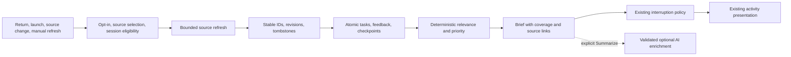

# Morning briefing and proactive analysis

Research date: 2026-10-21. **Verdict:** useful on-return briefings are feasible. Guaranteed 3–4 AM processing on an arbitrary closed MacBook is not a reliable public-app promise. The approved MVP direction is local structured cards available or refreshing on return, with cloud enrichment only when the user invokes it. This feature follows the first explicit-text AI release.

## Scheduling feasibility

Distinguish waking hardware, having a logged-in user session, unlocking credentials, reading authorized local data, reaching a network and completing inference. None implies the others.

| Mac state | Practical outcome and required product behavior |
|---|---|
| Awake, app running, session usable | An owned timer can start bounded work; exact execution still depends on process/network availability. No reason to force a 3 AM schedule instead of incremental daytime refresh. |
| Sleeping, lid open | A calendar `launchd` trigger may be serviced after wake. It does not establish a usable foreground session at the scheduled hour. Use catch-up. |
| Lid closed, battery or power connected | No general guarantee that third-party app code gets a long, network-capable session. Supported closed-display configurations and system maintenance wakes are not universal execution guarantees. |
| Shut down or FileVault pre-login | The menu-bar app/user Keychain/EventKit session is unavailable. Scheduled power-on, even where supported/configured, is not login or unlocked app data. |
| Locked session/Keychain unavailable | Skip protected reads/AI key use that require interaction. Never show credentials or permission prompts overnight; retry after user return. |
| Offline or provider unavailable | Display cached cards with explicit last-sync/coverage, update local sources, defer enrichment. Do not label cached results current. |
| App quit/not registered at login | No in-process background work. Next manual launch catches up; optional launch-at-login is separate new work. |

Apple documents `pmset` scheduling and `StartCalendarInterval` catch-up after sleep, including the distinction from a powered-off computer. These are scheduling mechanisms, not an end-to-end availability SLA. `pmset` changes machine-wide power scheduling and commonly needs elevated authority; it can conflict with the user's settings. Idle power assertions prevent particular idle sleep conditions during owned work; they do not boot a Mac or guarantee closed-lid execution. Do not install a root daemon, alter power policy, or reuse the experimental LidAwake helper for this feature. [Apple power scheduling](https://support.apple.com/guide/mac-help/schedule-your-mac-to-turn-on-or-off-mchl40376151/mac), [Apple scheduling guide, archived](https://developer.apple.com/library/archive/documentation/MacOSX/Conceptual/BPSystemStartup/Chapters/ScheduledJobs.html).

Power Nap/dark wake and background scheduling are opportunistic system behaviors, not a documented general right for Notchium to scrape user apps unattended. A hardware/OS experiment could characterize some configurations, but cannot justify a blanket overnight guarantee.

## Architecture alternatives

“Local” scheduling means running on the Mac; the proposed primary LLM still uses an external API. A rules-only fallback can be entirely local. Local scheduling plus cloud inference is not offline AI.

| Strategy | Strengths | Limits | Recommendation |
|---|---|---|---|
| Mac-only scheduling/source analysis | EventKit and private local sources remain local; no backend | Sleep/off/login/Keychain limitations; timers disappear on quit; network needed for external LLM | Best initial source/ranking path, with on-return catch-up |
| Cloud scheduled analysis | Can run while Mac is off for cloud-authorized sources | Cannot directly query a sleeping Mac's EventKit, AX or local files; needs backend credentials, account infrastructure, hosting, policy review | Conditional future option; not compatible with assuming all service operations are free |
| Hybrid | Local cards/catch-up plus optional scheduled cloud-source summaries | Reconciliation, freshness and duplicate ownership become more complex | Recommended long-term architecture if constraints later permit backend operations |

Cloud scheduling improves the availability of Gmail/Google Calendar analysis, not local Apple Reminders. A previous Mac-uploaded snapshot may be stale; label its observation time. Neither Google Calendar nor Apple Calendar access grants Gmail.

## Existing components to reuse

See [01](01-current-architecture.md) for complete paths. Concrete anchors are `NotchiumPackage/Sources/NotchiumServices/CalendarService.swift` (`CalendarService`, `RealCalendarService`); `NotchiumCalendarFeature/CalendarActivityModel.swift`; `NotchiumServices/ReminderService.swift` (`EventKitReminderService`); `NotchiumCore/SuggestionIdentity.swift`; the pure `NotchiumProactiveFeature` scoring/feedback/interruption files; and `NotchiumDynamicIsland/ActivityCoordinator.swift`/`NotificationCoordinator.swift`.

Calendar is already selected-source, change-driven and wake-aware. Its summary UUIDs are process-local and insufficient for persistent task identity. Reminder authorization/creation exists; reading incomplete reminders, completing them and tracking saved identities do not. Existing suggestion feedback is in-memory and has no serialization contract. Add a composition-owned runtime and storage adapter; keep the policy module pure.

## Source integrations and dependencies

| Source | Initial route | Additional work/API/permission |
|---|---|---|
| Apple/local Calendar | Existing selected EventKit calendars | Calendar full access; durable event/occurrence projection, selected-source AI consent and freshness. Read summaries only initially. |
| Google Calendar | Calendars already synced to macOS may appear through EventKit | No new Google OAuth needed for that route; validate account sync coverage. Direct Calendar REST is optional for cloud operation or richer fields; read-only scopes, OAuth, incremental token handling and provider-ID reconciliation required. |
| Apple Reminders | Extend the existing EventKit boundary with a read-only inventory contract | Existing full access is not new consent for AI transmission. Add pending fetch, due components, completion observation and stable mapping; expand purpose explanation. Completion writes are a later approved action. |
| Gmail | Conditional connector after verification/cost gate | Native-app OAuth, restricted Gmail scopes, thread/message projection, aliases, incremental sync and explicit cloud egress policy. No mailbox connector in MVP. |
| Other messages/documents | Explicit imports/selected content only | No generic access to all chat apps or Notification Center. Per-service connectors need their own authorization and policy review. |

Direct Google Calendar uses persisted sync tokens, paginated deltas and full resync after invalidation; it must not be fetched again independently if the same calendar is also projected from EventKit. Choose an owner or maintain explicit cross-provider aliases. [Google Calendar incremental sync](https://developers.google.com/workspace/calendar/api/guides/sync).

No new external package is required for local cards. Foundation/EventKit/Security/CryptoKit suffice for proposed initial adapters and encrypted archive. Google/cloud work adds services and maintenance even if implemented over REST without a library.

## Recommended data flow



`MorningBriefService` owns refresh/coalescing and brief assembly, not permission dialogs or task mutation. `ProductivityRuntime` consumes immutable source projections; `TaskStore` owns transactions and durable feedback. `BriefRefreshScheduling` translates native wake/activation notifications into typed triggers; it is not a second window controller.

Proposed sketch:

```swift
protocol ProductivitySource: Sendable {
    func refresh(after checkpoint: SourceCheckpoint?) async throws -> SourceDelta
}
protocol MorningBriefProviding: Sendable {
    func refresh(_ trigger: BriefRefreshTrigger) async -> BriefSnapshot
    func respond(to taskID: UUID, with response: BriefResponse) async throws
}
```

On return: load cached normalized cards immediately; coalesce wake/screens-wake/activation into one generation; refresh permitted sources independently; commit each source's delta and checkpoint atomically; rebuild deterministic cards; update the visible brief. Do not wait for the slowest connector or an LLM before showing useful local facts. An initial once-per-civil-morning surfacing rule is distinct from content freshness and explicit refresh.

## Unanswered email and commitment logic

Unread is not unanswered. A later connector should:

1. Build account identity from the authenticated account and verified/configured sending aliases. Group by provider thread, retaining message-level participants, timestamps, Message-ID, reply headers, draft/sent status and automation indicators.
2. Identify the most recent relevant human request addressed to the user. A later message from the user may resolve it; a newsletter, automated notice, reply from someone else, or draft may not.
3. Separately identify outbound requests where the user is waiting for another person. Do not classify every sent email as awaiting reply.
4. Exclude automated/list traffic conservatively, respect selected labels/accounts, business-day thresholds and explicit “no reply needed.” Show “May need a reply” or “Waiting for response,” with the evidence and an easy correction.
5. Support multiple outstanding requests within one thread; a single thread-level boolean is insufficient. Never infer fulfillment from merely opening a message.

Use rules for direction/ordering and an optional bounded classifier for whether a request exists. Store evidence message IDs and exact spans. A generated confidence number is not calibrated. No algorithm can establish that all real-world commitments were fulfilled from mailbox data alone.

## Deadlines, memory, and incremental work

AI extraction must return source revision, exact supporting span, proposed owner/action, verbatim temporal phrase, reference time/zone, and an explicit unknown/ambiguous due state. Local validators check that evidence exists and dates follow supported arithmetic. “Next Friday,” “end of term,” conditional requests and forwarded messages require clarification; do not invent deadlines. Extracted items are proposals until confirmed. Confirmed EventKit due dates remain authoritative.

Task state distinguishes complete, dismiss, snooze, decline extraction, and source-deleted. Dismiss hides a suggestion occurrence; it does not complete an external reminder. Snooze delays presentation unless the user separately approves changing a source due date. Completion of a Notchium-owned task is distinct from completion of a linked external task. Preserve feedback across source content revisions where the same obligation survives.

Use source/account/object/series/occurrence identity, with an internal durable task ID and reconciliation aliases. Due dates preserve date-only vs timed meaning and source time zone. Recurrence belongs to a series, but completion/dismissal normally affects an occurrence. Calendar moves/reschedules/sync resets need explicit reconciliation; similar titles alone cannot merge tasks automatically. Multiple sources may support one task, with a user-reviewable merge.

Incremental sync/checkpoints plus content/revision hashes avoid reprocessing old material. Cache by extractor/schema/model version; reprocess only changed eligible evidence, with bounded lookback. Keep lightweight suppression/tombstone records under a documented retention policy; delete sensitive source excerpts as soon as unnecessary. Gmail history cursors can expire and return 404, requiring a bounded resync; desktop clients can poll changes without a Pub/Sub backend. [Gmail sync](https://developers.google.com/workspace/gmail/api/guides/sync), [Gmail push architecture](https://developers.google.com/workspace/gmail/api/guides/push).

## UI, privacy, and failure behavior

Show a small on-return card with a count and next relevant item; opening it reveals a bounded list in the existing shell. Use the companion window for a longer brief. Each item offers source, dismiss and presentation-snooze; completion appears only for locally owned tasks or a later verified writable source. Preserve current meeting warnings/timer ownership and avoid a second unsolicited reminder for the same event. Route interruptions through existing policy with caps, cooldowns, protected surfaces and quiet-during-focus preference. If system Focus is unavailable, do not claim it is off.

Permissions are Calendar/Reminders only when enabled, optional login-item registration, and optional connector OAuth. No Accessibility, Screen Recording, camera, microphone, Notification Center reader, administrator helper or Full Disk Access is needed for structured local briefs. AI egress is a separate user action under the approved plan. Denying a source leaves the other cards usable. Account revocation purges source payload caches, invalidates proposed actions, and marks coverage incomplete.

Failures to test include timezone/DST changes, travel across midnight, repeated wake events, app quitting mid-transaction, locked Keychain, permission revocation, removed calendar/list, empty vs unavailable sources, stale caches, account alias mistakes, cursor expiration, delayed cloud replies, recurring event exceptions and duplicate obligations. A partial brief must name unavailable integrations and observation times; never say “nothing outstanding” when sources failed.

## Ordered implementation and acceptance

Complexity: **medium-high** for local durable briefs; **high** for reliable mail-derived commitments; cloud scheduling adds operational work beyond client code.

1. Define source/task/occurrence models and synthetic fixtures; resolve Calendar identity before persistent suppression.
2. Build read-only Reminders inventory and selected Calendar projection; test TCC and no cloud egress.
3. Add encrypted transactional TaskStore, feedback, checkpoints and future-schema recovery.
4. Add coalesced return/source refresh and deterministic ranking; retain pure policy boundaries.
5. Render coverage-aware cards through existing activity ownership; add manual refresh and companion detail.
6. Add explicit optional AI summarization with evidence validation and budget controls.
7. Only after policy/cost approval, add Gmail or direct Google Calendar; evaluate cloud scheduling independently.

Local briefing MVP acceptance:

- First return/launch shows cached state with freshness and begins one coalesced refresh; no exact overnight completion promise.
- Selected Calendar and authorized incomplete reminders yield source-backed cards; denied/unavailable sources do not block remaining cards.
- Dismiss and snooze survive quit/relaunch; recurrence, reschedule and sync-reset fixtures do not duplicate or resurrect suppressed occurrences incorrectly.
- No fabricated due date or automatic external mutation; a failed source cannot produce an “all clear.”
- No cloud request without explicit invocation; no power-policy changes, continuously running polling loop, or new privileged helper.
- Deterministic unit tests cover time, ranking, identity and crash consistency; native ad-hoc permission/Keychain tests cover supported macOS versions before release.

Production hardening adds calibrated extraction evaluations, account/alias management, connector deletion/revocation, durable write verification, source retention audits, migration tests, load/energy measurements and cost controls. Optional cloud processing additionally requires a funded/operated backend and Gmail assessment review; under the present constraints it remains a conditional design, not a promised phase. Shared models and security details: [06](06-shared-ai-architecture.md), [09](09-security-and-distribution.md).
