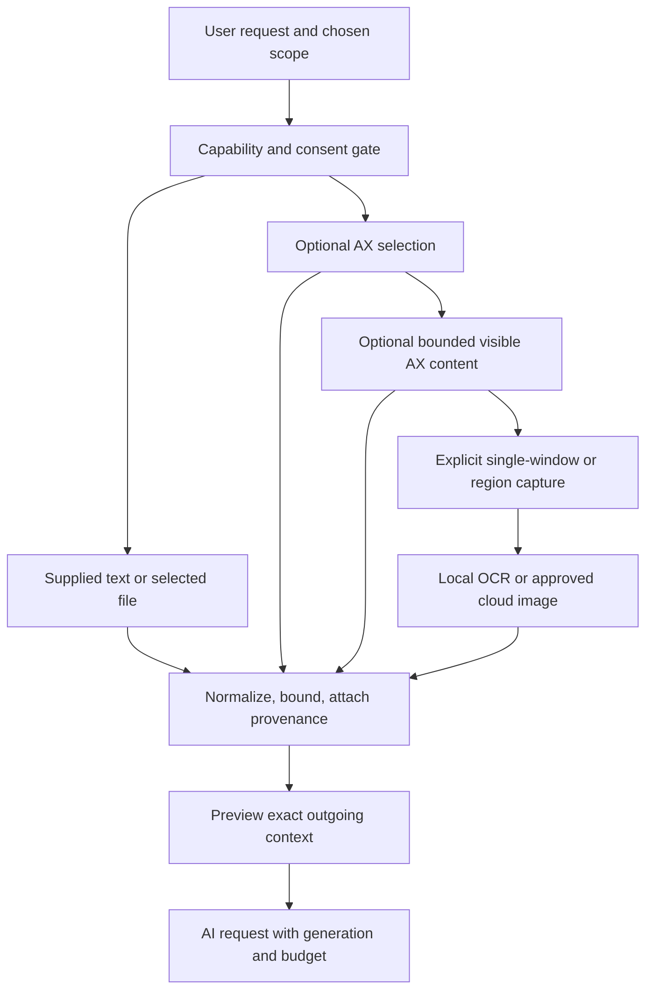

# Context-aware notch chat and ContextEngine

Research date: 2026-10-21. **Verdict:** a compact assistant with explicitly supplied text is a practical first release. On-demand selected-text, file and single-window context are feasible follow-on capabilities. “Understands everything currently open” is neither an accurate permission model nor a reliable context promise.

## MVP and alternatives

The agreed first release takes text deliberately typed/pasted into Notchium, streams an advisory answer and offers explicit Copy. There is no screen capture, AX read, automatic Clipboard read, account connector or external action in this first slice. This validates model usefulness, latency, focus, budgets and the compact UI before adding TCC-dependent integrations.

| Context architecture | Advantages | Limits / recommendation |
|---|---|---|
| Explicit text only | No cross-app capture permission; precise egress preview | Manual input friction, incomplete evidence; first release |
| AX-first on-demand | Good text/token efficiency when the app exposes selection/visible text | Browser/app-dependent, incomplete/unresponsive trees; optional next step |
| Screenshot-first | Works for visual material where text extraction fails | Broad incidental disclosure, OCR/vision errors, no offscreen content, higher cost |
| Authorized file-first | Stable page/source references and efficient long-document retrieval | User must select the actual document; no assumption that an active window reveals file access |
| Hybrid with explicit escalation | Best capability/fidelity tradeoff | More policy/test work; recommended ContextEngine evolution |

A screenshot is evidence of visible pixels at a time, not a live connection to the user's documents. Vision can explain a diagram but may miss small symbols or math. A model must state when a proof, error or textbook excerpt is incomplete.

## Existing components to reuse

`NotchiumPackage/Sources/NotchiumFeature/AppEnvironment.swift`/`NotchiumApplicationController.swift` supply composition and lifecycle. `NotchiumDynamicIsland/NotchPanel.swift`, `NotchiumPanelController.swift` and `NotchiumDisplayCoordinator.swift` own focus/presentation/display behavior. `NotchiumServices/ClipboardService.swift` supports explicit Copy, and Shelf's `FileActionPerforming`/`QuickActionResources` demonstrate native panels/bookmark lifetimes. Share patterns through narrow services rather than importing another feature's concrete model.

`NotchiumServices/ScreenshotService.swift` is **saved-file detection**, not current-screen capture. Existing system audio authorization is not Screen Recording authorization, and volume-key Accessibility approval is not consent to send app text to a provider. New context adapters are necessary. The generic `RealPermissionAuthorizer` is a scaffold; the functioning setup path is `NativeOnboardingPermissions`. Full source mapping: [01](01-current-architecture.md).

## ContextEngine responsibilities

`ContextEngine` is an actor-coordinated pipeline of small providers. It selects among explicitly authorized inputs, bounds data, assigns evidence and freshness, and returns an immutable `ContextPackage`. It does not choose the user's intent, own chat history, call the model, approve actions or acquire screen permissions silently. Rich source-specific metadata remains typed and optional.

This is an escalation policy, not a command to automatically collect every possible layer. If supplied text answers the question, stop there. A request such as “Explain this diagram” can explicitly choose an image. If AX fails, offer a capture choice rather than silently escalating to a screenshot. An authorized file/document extractor may outrank visible AX text when the user specifically asks about that file.

Proposed boundaries:

| Service/protocol | Owns |
|---|---|
| `ContextProviding` / `ContextEngine` | Selection policy, collection deadline, generation, immutable package |
| `FrontmostApplicationProviding` | App/window identity observed before opening Notchium; typed change events |
| `FocusedContextProviding` | AX trust check, bounded selected/visible text and role metadata; adapter-local AX handles |
| `ScreenContextCapturing` | Explicit content filter/region, single frame, pixel bounds, resource release |
| `LocalTextRecognizing` | Vision OCR, supported language/revision, text regions and uncertainty |
| `DocumentTextExtracting` | Selected-file access, content fingerprint, text/pages, locked/unsupported states |
| `DocumentRetrieving` | Bounded local chunks/search and stable citations; later semantic retrieval |
| `ContextEgressAuthorizing` | Provider/purpose/context-digest receipt and excluded-source policy |
| `AIChatModel` | UI state, user prompt/manual edits, current operation and streaming presentation |

The shared model in [06](06-shared-ai-architecture.md) includes origin, capture/expiry, generation, consent, completeness, text/image parts, extraction method and evidence ranges. Add truncation metadata and token/byte estimates. Do not put raw `AXUIElement`, `EKEvent`, `PDFDocument`, `NSImage`, `NSScreen`, credentials or mutable file handles in Core or persistent task records.

## Capture and permissions

Apple supplies `SCScreenshotManager` for single-frame capture with a content filter. Installed macOS 27 SDK headers mark `captureImage(contentFilter:configuration:)` available since macOS 14; newer screenshot APIs also meet the macOS 26 deployment minimum. Use a selected window/region with explicit scaling/coordinate transforms and bounded dimensions. Exclude Notchium's own surfaces through the capture filter; do not assume window `sharingType` is a universal exclusion guarantee. [SCScreenshotManager](https://developer.apple.com/documentation/screencapturekit/scscreenshotmanager).

Direct capture uses Screen Recording authorization; a system content picker can offer a more scoped sharing route, but its exact consent/lifetime behavior must be validated in the packaged app. Check capture permission separately from Core Audio tap and CG event-listen/post permissions. Do not treat a saved screenshot-folder bookmark as a screen grant. Locked/protected content, windows disappearing mid-capture and OS privacy UI may produce errors or missing pixels.

AX selection/visible text needs Accessibility trust, not Screen Recording. Basic frontmost-app metadata does not justify a continuous browsing history. Native-selected files need picker/bookmark access, not Full Disk Access. Local OCR needs no additional TCC beyond authorized acquisition of the image. No microphone or camera permission is needed. A conventional hotkey should use registration rather than monitoring every key; exact ad-hoc behavior is a qualification gate.

No continuous screen stream, periodic screenshots, background content scraping, keylogging or automatic clipboard history ingestion. Focus/window-change observation is for invalidating a requested snapshot, not collecting content in the background.

## OCR, vision and long documents

Vision `VNRecognizeTextRequest` is an available local OCR option. Query supported recognition languages/revision; confidence on a text region is not semantic correctness. Local OCR reduces transmitted pixels and often token cost, but loses diagrams, equation layout, code indentation and reading order. Let the user choose the excerpt/image and display uncertainty. Cloud vision remains an explicit image-sharing choice, not an automatic fallback. [Apple Vision OCR](https://developer.apple.com/documentation/vision/vnrecognizetextrequest).

For PDFs, start with PDFKit text per page, retaining page index, printed page label where available, character ranges and content fingerprint. Installed headers expose nullable `PDFPage.string`, document lock status and page access; scanned PDFs need page rendering plus OCR. Password-protected files require an explicit unlock/error path and no password logging. Do not promise DRM bypass or flawless extraction of figures/tables. [PDFKit page text](https://developer.apple.com/documentation/pdfkit/pdfpage/string).

Do not send an entire textbook by default. Proposed evolution:

1. Selected-page/text extraction with a capped byte/page budget.
2. Page-aware chunking and local full-text/lexical retrieval over authorized documents.
3. Return top relevant passages with source/page references, then generate an answer grounded in them.
4. Add embeddings/RAG only if lexical recall fails a representative evaluation. Decide local vs cloud embeddings separately; cloud embeddings also transmit document text and incur retention/cost obligations.
5. Add document revision tracking, duplicate fingerprint handling and index cleanup. Never reuse another account/document's retrieval context because its title matches.

SQLite FTS is a possible system-backed index later; it introduces schema/module integration and encryption questions but no reason to adopt a remote vector database for MVP. This is a proposed future dependency, not an implemented capability. Begin with small selected excerpts and no persistent index. Text extraction/indexing happens locally before cloud transmission; users preview the retrieved passages, with an explicit option for page images when needed.

## UI and invalidation behavior

The approved design adds an invoked AI surface inside the existing 524×266 expanded shell, via a new renderer contract and presentation mode. It does not add a seventh page or resize existing pages. Extend existing auxiliary/keyboard ownership deliberately so only the active surface receives input and hidden content is inaccessible. A normal app-owned window handles long answers, citations, large previews and later document workflows. That window is a client of the same session, not another AI engine.

At invocation, save origin identity before focus moves to Notchium. Show a scope chip such as “Pasted text,” “Selection from Safari,” or “Window image,” provider destination, capture time and a preview/remove action. Each new turn reuses only deliberately attached context. Auto-live context expires on app/window/tab/document changes, sleep/lock or revocation; never refresh a prior excerpt into a new app silently. An answer already in progress may finish as an answer about the labeled historical snapshot; it cannot gain authority to modify the new foreground app. Reject late capture results from earlier generations.

One active request, visible progress, Stop, Retry and editable prompt are enough initially. Bound/coalesce text updates so streaming does not rebuild the full shell. Do not equate first-token latency with total response latency. Proposed engineering targets: local UI acknowledgement within 100 ms on representative hardware; instrument first-token/total latency and cancellation cleanup rather than promise provider-dependent seconds. All performance numbers here are targets requiring measurement.

## Security and failure model

Screen/doc text is untrusted data. Instructions within it cannot change provider, add tools, access other files or authorize uploads. MVP has no tools, which sharply limits prompt-injection impact, but fabricated answers and disclosure through generated text remain possible. Block automatic fetching of image/link URLs embedded in model output. Provider credentials and local file paths are never attached as prompt metadata. Optional sensitive-app exclusions are checked before capture; users can review/remove context, and automatic redaction is not a guarantee of removing every secret.

Network failure shows a retryable state without replaying a partially generated answer automatically. Empty AX text, unsupported app, OCR failure, corrupt PDF, locked file, missing bookmark, permission denial, outdated context and budget exhaustion get distinct states/fallbacks. Unsupported context falls back to manual input, preserving unrelated Notchium features. Default chat is session-only; explicit saved artifacts and their deletion use separate storage from Clipboard history.

## Implementation order, dependencies and acceptance

Complexity: **medium** explicit-text chat; **medium-high** reliable permission-aware AX/window capture; **high** large-document retrieval and cross-app context quality. Foundation/AppKit/Security/CryptoKit suffice initially. ScreenCaptureKit, Vision and PDFKit are platform frameworks added only when those features ship; no external Swift AI SDK is necessary.

1. Implement shared Core/request/events, mock provider and stream UI; wire lifecycle and a conventional shortcut/menu entry.
2. Add OpenAI direct transport, Keychain credentials, egress disclosure and budgets; use session-only explicit text.
3. Add companion window/source rendering and explicit saved-artifact controls if needed.
4. Run a packaged AX/ScreenCaptureKit permission spike on macOS 26 and current OS; then add selection and scoped screenshot capabilities separately.
5. Add selected PDF text/page extraction; follow with bounded local retrieval only after the use case is validated.
6. Add Anthropic and calibrated cross-provider evaluation without silent provider fallback.

First-release acceptance requires usable typed/pasted questions, streaming/Stop/retry, explicit Copy, correct usage/error states, no default chat persistence, no cross-app reads or new capture permissions, unchanged existing six-page geometry/navigation and zero-cost release-policy compatibility. Mocks must verify no real accounts or Keychain access; UI tests cover focus, text selection, Escape, multiple displays and companion ownership.

Screen-context acceptance later additionally requires consent before each newly enabled scope, source identity/freshness preview, single-frame acquisition, no raw screenshot writes, bounded AX calls, permission revocation cleanup, stale-generation rejection and manual-input fallback. Native tests cover Chrome/Safari/Firefox, Preview PDFs, secure fields, no accessible text, multiple windows/displays, Retina scaling, sleep/wake and source disappearance. No browser support is claimed until measured.

Production hardening adds retrieval recall/groundedness evaluations, multilingual OCR/math/diagram tests, encrypted index deletion, memory/energy/latency measurements, provider-policy updates and packaged ad-hoc update/permission persistence checks. Related email and agent consumers: [03](03-contextual-email.md), [05](05-computer-use.md).
