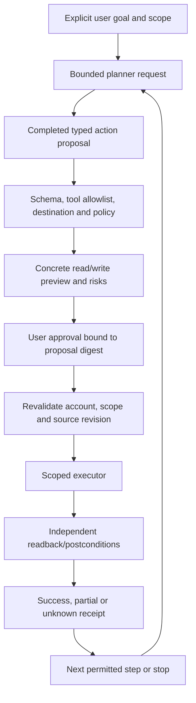

# AI task execution and computer use

Research date: 2026-10-21. **Verdict:** narrow API-backed workflows are feasible after read-only assistance. Browser automation is a conditional later capability. Unrestricted macOS desktop agents are high-risk, expensive to qualify and outside the initial release. A provider model does not acquire access to the user's Mac merely because its API supports computer use.

## What providers actually supply

Current OpenAI documentation describes computer-use SDK drivers, hosted/partner environments and direct Responses execution loops. For a custom environment, the application supplies the runtime/driver, executes requested operations and returns observations. Current examples also use ordinary function tools connected to browser/desktop execution services; do not hardcode an older `computer-use-preview` recipe as the only current integration. Hosted containers or partner browsers are distinct environments, not the signed-in local desktop. [OpenAI computer use](https://developers.openai.com/api/docs/guides/tools-computer-use).

Anthropic's current direct API documents `computer_toolset_20260801` as a client toolset: model calls are executed in the developer-controlled environment. Its separate `browser_toolset_20260801` works with a browser the application runs and includes structured page interaction. Tool/model/platform combinations are version-specific; earlier computer tool types are not universally supported by newer models. The docs currently distinguish these client toolsets from Managed Agents availability. [Claude computer use](https://platform.claude.com/docs/en/agents-and-tools/tool-use/computer-use-tool), [Claude browser use](https://platform.claude.com/docs/en/agents-and-tools/tool-use/browser-use-tool).

Notchium must still implement authentication, environment provisioning, observation, action validation, consent, budgets, cancellation, result verification and recovery. Neither provider guarantees safe or correct task completion. Re-fetch compatibility documentation before implementation; these API names are a dated research snapshot, not a forever contract.

## Architecture comparison and recommendation

| Mode | Example | Reliability/security/operational implications | Priority |
|---|---|---|---|
| Structured tools | Extract selected PDF rows → preview → write exact Google Sheet range | Narrow parameters and readback; clear scope; account/OAuth still required | First execution lane |
| Isolated browser | Navigate public site and collect cited facts | Dedicated profile/allowlisted domains contain damage; dynamic pages/login/anti-bot still fail | Later read-only experiment |
| General desktop | Click arbitrary app controls using AX/images/events | Mutable user focus, coordinates, broad grants and partial rollback; large app/version test matrix | Defer indefinitely until concrete demand/evidence |
| Hybrid | APIs for writes, isolated browser for unsupported reads, AX only for qualified local tasks | Most practical long-term route; policy must follow data/actions across boundaries | Recommended long-term architecture |

For “read a textbook,” use selected-file PDF extraction/retrieval from [04](04-screen-aware-chat.md), not page-by-page desktop clicking. For “fill a Google Sheet,” use range-specific API writes and post-write reads, not typing cells visually. Google explicitly supports values get/update/batch operations; permissions still need independent authorization. [Google Sheets values](https://developers.google.com/workspace/sheets/api/guides/values).

A dedicated browser process is not automatically a security sandbox. It needs process/OS isolation appropriate to the threat model, a separate profile, constrained files/network, limited credentials, no host filesystem mounts and a clear lifecycle. Hosted environments introduce costs and data transfer; bundling Chromium/automation helpers introduces executable/dependency/signing maintenance incompatible with assuming today's single-executable DMG is sufficient.

## Existing components to reuse

`NotchiumPackage/Sources/NotchiumQuickActionsFeature/QuickActionRunner.swift` has useful validation/in-flight/cancellation patterns. `NotchiumServices/ShortcutService.swift` validates user-selected shortcut identity and executes a fixed command with arguments; it is not a safe arbitrary-code agent executor. A Shortcut can itself send or delete data, so pinning is not approval of every future AI invocation. Prefer explicit user execution of opaque Shortcuts outside the autonomous tool loop initially.

`NotchiumServices/QuickActionWorkspace.swift`/`QuickActionResources.swift` and `NotchiumShelfFeature/FileActions.swift` demonstrate selected-resource resolution and native open/reveal/sharing. `NotchiumCore/SuggestionCandidate.swift`'s `ProactiveAction` explicitly describes actions without authorizing/executing them. Reuse that separation. Existing `ActivityCoordinator` owns presentation priority, not approval policy. No general desktop executor, browser runtime, ToolRegistry or action audit store exists. [01](01-current-architecture.md) identifies exact ownership.

## Proposed execution pipeline



Proposed contracts:

```swift
protocol ActionExecuting: Sendable {
    func preview(_ proposal: ActionProposal) async throws -> ActionPreview
    func execute(_ action: AuthorizedAction) async throws -> ActionResult
    func verify(_ result: ActionResult) async throws -> VerificationResult
}
protocol ActionApprovalProviding: Sendable {
    func authorize(_ preview: ActionPreview) async throws -> ActionAuthorization
}
```

`ToolRegistry` is an immutable injected map of known tool definitions and executors. Each tool declares parameter schema, read/write scope, target constraints, required permissions, idempotency semantics, cost, pre/postconditions and whether compensation exists. `ActionApprovalService` mints short-lived, single-use authorizations bound to user intent, normalized argument hash, account/resource, revision, tool version and session. IDs or model-written “approved” fields are not authority. `WorkflowCoordinator` serializes mutations and owns checkpoints; executors stay narrow by domain instead of a giant `ComputerActionExecutor` with every privilege.

The MVP assistant advertises **no tools**, so model output cannot execute anything. A later first tool may propose a Notchium-owned artifact or a new reminder through a reviewable native form; this is a new execution milestone, not part of the advisory release. A Google Sheet workflow needs a user-selected spreadsheet/range, minimal OAuth scopes, exact value diff, input mode control (e.g. literal data rather than untrusted formulas), overwrite protection and readback. All source/destination accounts must appear in the approval preview.

## Action policy and prompt injection

| Class | Default handling |
|---|---|
| Read chosen local excerpt | User's explicit request and selected scope; no unrelated filesystem enumeration |
| Send selected evidence to model | Egress disclosure/receipt binding provider and content; separate from read permission |
| Write app-owned new artifact | Show destination/content; approval per artifact or tightly bounded approved workflow |
| Modify external reminder/document/range | Concrete diff, scope/revision checks, explicit approval and verification |
| Send mail/message, submit form, share/upload externally | Separate final-step approval; excluded from first execution lane |
| Delete, purchase, change permissions, handle passwords/admin controls | Deny initially; no generic escape hatch or blanket “allow everything” setting |

Treat tool output, websites, PDFs, email, OCR and retrieved text as adversarial observations. They may contain instructions to upload files, change tools, ignore approval or visit an attacker URL. Keep task instructions separate from observations; enforce permissions in executable policy, not prompts. A malicious document cannot widen a file grant or choose an external destination. Bound output URLs/redirects, deny local/internal metadata network access where not explicitly required, strip tool secrets from model-visible errors, and never give the model a raw shell/AppleScript/eval capability in the desktop app.

Prevent cross-tool exfiltration: authorized reading of one textbook does not authorize uploading it to a website, even if another tool can navigate there. Approval summaries must be generated from normalized validated actions, not solely from a model's friendly description. For multi-action provider batches, validate every member and stop at an approval/state boundary; do not execute an entire returned batch blindly.

## macOS execution and permissions

Qualified local automation could use AX for semantic element reads/actions, screenshots for observations, and CG keyboard/mouse events for targets lacking semantic actions. Accessibility trust, event-listen/post checks and Screen Recording are distinct. Apple Events automation has target-specific TCC and Hardened Runtime considerations; current Spotify approval authorizes Spotify behavior, not arbitrary applications. Input Monitoring may apply to particular event-observation designs and should not be requested preemptively for registered hotkeys. No root/admin helper or Full Disk Access is required for the recommended structured-first lane.

Desktop execution must stop on user input/focus switch, screen lock, app/window replacement, sleep, permission revocation or emergency Stop. Coordinate transforms must handle Retina, multi-display origins, window movement and stale screenshots. Do not drive secure fields, password dialogs or OS permission prompts. A live user's desktop is contested state; the model cannot assume exclusive ownership.

## Recovery, audit and output verification

Persist a workflow plan/checkpoint and sanitized private receipts before external writes. A timeout after submission means **unknown outcome**, not failed: query the destination before retrying. Use API idempotency keys when documented; otherwise maintain operation IDs and reconcile using returned resource IDs/expected content. Do not promise exactly-once external side effects where the API offers no such mechanism.

Rollback varies by tool. A new app-owned file can be removed with consent; an overwritten spreadsheet may be restored only if a known preimage still matches and no collaborator has edited it; a sent email cannot generally be unsent by Notchium. Label compensation/rollback limitations in the preview. Never automatically “undo” by overwriting newer user/collaborator changes. Cancellation stops future actions and observations but may not reverse an in-flight server operation.

Private audit records include operation/time/tool class, approved scope/digest, outcome and verified external references, with encrypted sensitive details and deletion controls. Shared diagnostic logs contain only bounded status/counters. Store screenshots only if the user explicitly chooses an incident artifact, with preview and retention; default screenshot recording is off. Verification uses APIs/readback or fresh bounded observations and acceptance checks, not the planner's self-reported success.

## Ordered implementation and dependencies

Complexity: **high** structured multi-step execution, **very high** browser/desktop automation. External dependencies are connector APIs/OAuth, a future browser runtime or hosted environment if selected, and provider computer-use support; none is required in the advisory MVP.

1. Finish read-only chat, source evidence, budgets and context lifecycle.
2. Define typed tool/approval/action-result contracts and a fake executor test harness.
3. Ship one narrow reversible structured action with concrete preview, approval, idempotency strategy and readback.
4. Add workflow checkpoints, interruption recovery and private receipts before chaining writes.
5. Evaluate a dedicated read-only browser workflow on allowlisted public domains; choose isolation/distribution funding explicitly.
6. Add authenticated browser work only with per-account credential handling and final-step approval boundaries.
7. Consider a single allowlisted desktop app workflow only if structured/browser routes cannot solve demonstrated demand. No general desktop launch commitment.

## Acceptance and production hardening

First execution milestone accepts only known tool IDs and schemas, binds approval to exact destination/content/revision, rejects stale/missing approvals, makes one controlled write, verifies it, and correctly reports partial/unknown outcomes. Stop/relaunch never replays a mutation blindly. Malicious source fixtures cannot invoke additional tools, leak unrelated files, change destination or forge approval. Fault injection tests cover crashes before/after submission, timeouts, duplicate callbacks, edited resources, OAuth revocation and user interruption. Unit/integration tests use sandbox fixtures and fake accounts, not the user's live production data.

Browser hardening requires isolation/egress tests, credential boundaries, authenticated origin checks, session cleanup, anti-bot/login failure behavior, browser version pin/update policy and per-workflow success measurements. Desktop hardening additionally needs native permission matrices, multi-display/Space/focus testing, emergency stop, non-English apps, unsupported AX and precise claim limits. The absence of a safe rollback path can disqualify a workflow even if the model can usually complete it.

Do not build purchases, autonomous sending/deletion, privileged execution, continuous screen surveillance, arbitrary scripts or an agent marketplace in the first release. Long-term success is verified authorized outcomes for a small number of valuable workflows, not the number of exposed tools. Security/distribution gates: [09](09-security-and-distribution.md).
