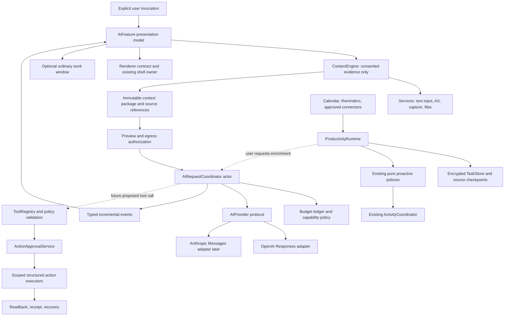

# Shared AI architecture

Research date: 2026-10-21. This is a proposed design, not implemented API surface. Existing components and constraints are verified in [01](01-current-architecture.md); delivery order is in [08](08-implementation-roadmap.md).

## Decisions established with the developer

Target individual students/knowledge workers. Start with explicit text input and advisory output, user-invoked cloud requests, BYOK, OpenAI first and Anthropic later. Keep distribution zero-cost/ad-hoc, existing notch geometry and six-page navigation. Allow a normal window for longer work. Chats are session-only unless explicitly saved; later task feedback is durable. Spending controls stop new app requests at configured limits. Morning refresh happens on return; Gmail, extensions, scheduled cloud processing and external actions are conditional later capabilities.

## Architecture and ownership

Use a small provider abstraction over direct HTTPS. Avoid a third-party AI framework, embedded Node/Python runtime, generic agent SDK, or new backend in the MVP. Foundation networking, Security, CryptoKit, existing dependency injection and native UI are sufficient for the first slice. An abstraction is useful for differences in streaming, refusals and usage; a universal lowest-common-denominator chat dictionary is not.



Arrows show data/use relationships, not permission inheritance. A context package does not grant action authority. Models cannot call OS adapters directly.

| Boundary | Proposed home and responsibility | Exclusions |
|---|---|---|
| Immutable contracts | `NotchiumCore`: requests, source identity, context receipts, task/action values, errors, budgets | Foundation-only; no AX/EK/NSImage/provider SDK types |
| Native/provider adapters | Small files in `NotchiumServices`: `OpenAIProvider`, later `ClaudeProvider`, `FocusedContextProvider`, `ScreenContextCapturing`, `DocumentTextExtracting`, `AISecretStoring`, `GlobalShortcutRegistering` | No feature imports or UI; opaque framework handles stay adapter-local |
| Shared runtime | New `NotchiumAI` target: `AIRequestCoordinator`, `ContextEngine`, request policy, provider capability negotiation | No window selection or activity-priority ownership; not a god-object application state manager |
| AI presentation | New `NotchiumAIFeature`: `AIChatModel`, compact surface, source/usage UI | No networking inside views; no import of another feature's concrete model |
| Storage | `NotchiumPersistence`: optional saved AI artifacts, budget ledger, later `TaskStore`, source checkpoint archive | No reuse of Clipboard encryption keys; no plaintext sensitive defaults |
| Productivity integration later | A composition-owned `ProductivityRuntime` with read-only source adapters; a separate target when introduced | Leave `NotchiumProactiveFeature` pure; its architecture tests disallow actors/protocols/tasks/I/O |
| Execution later | `ToolRegistry` immutable injected allowlist, `ActionApprovalService`, separate executors by destination | No globally mutable registry; no generic shell execution API in the desktop app |
| Composition | Existing `AppEnvironment`, `NotchiumApplicationController`, display controller | Construction, lifecycle and routing only |

Start with two new targets, not a separate module for every proposed class. Additional target changes happen only in later implementation stages. Existing Calendar/Pomodoro/Shelf UI owners expose narrow projections or composition-injected use cases; AI features must not import their concrete implementations.

## Provider capability comparison

External documentation was retrieved through Context7 and official vendor pages on the research date. Support remains model/account/version specific.

| Capability | OpenAI direct API | Anthropic direct API | Normalized contract |
|---|---|---|---|
| Request interface | Responses API | Messages API | Typed input parts, purpose, selected provider/model, output requirements |
| Tools | Custom function calls returned to client; some distinct hosted tools | Client `tool_use`/`tool_result`; distinct server tools | Completed proposed calls only; never execute partial arguments |
| Structured output | JSON Schema output and strict tool argument constraints | `output_config.format` JSON Schema and strict tools on supported models | Versioned schema plus independent semantic/source validation |
| Streaming | Typed SSE events | SSE message/content-block events | Text deltas, refusal, usage, completion, typed failure; preserve provider-specific continuation privately |
| Vision | Image input on compatible models | Image content blocks on compatible models | Optional image parts, with byte/pixel/token budgets and source receipts |
| Computer use | Current docs support SDK drivers/own runtime and direct API execution loops | Client computer/browser toolsets executed by your application | Provider-specific planning adapter; shared local action policy, not identical wire formats |
| Limits | Account/project/model limits and billing/quota failures | Workspace/model/tier token/request limits | Bounded concurrency, cancellation, classified retry and user-facing quota recovery |

References: [Responses overview](https://developers.openai.com/api/reference/responses/overview), [OpenAI function calling](https://developers.openai.com/api/docs/guides/function-calling), [structured output](https://developers.openai.com/api/docs/guides/structured-outputs), [streaming](https://developers.openai.com/api/docs/guides/streaming-responses), [OpenAI vision](https://developers.openai.com/api/docs/guides/images-vision), [Claude structured output](https://platform.claude.com/docs/en/build-with-claude/structured-outputs), [Claude streaming](https://platform.claude.com/docs/en/build-with-claude/streaming), [Claude vision](https://platform.claude.com/docs/en/build-with-claude/vision). Execution-specific findings are centralized in [05](05-computer-use.md).

Schema validity does not establish truth, a correct date, or permission to act. A refusal, incomplete stream, unsupported combination or output limit is not success. Anthropic's documented structured-output/citation combination has restrictions; do not require native citation blocks and constrained JSON simultaneously without verifying the selected API combination. For task extraction, use explicit evidence IDs/ranges validated locally instead.

## Proposed data contracts

These are interface sketches. Associated domain types and encoders would be defined during implementation, not copied verbatim into application code.

```swift
struct SourceReference: Codable, Hashable, Sendable {
    let connector: String       // closed validated identifier in implementation
    let accountID: String      // opaque local alias, never an access token
    let objectID: String
    let occurrenceID: String?  // recurring occurrence, separate from series
    let revision: String
}

struct ContextPackage: Sendable {
    let id: UUID
    let generation: UInt64
    let capturedAt: Date
    let expiresAt: Date
    let origin: ContextOrigin  // app/window identity and optional tab/document
    let parts: [ContextPart]   // bounded text/image/excerpt values
    let evidence: [EvidenceSpan]
    let consent: ContextConsentReceipt
    let completeness: ContextCompleteness
}

struct AIRequest: Sendable {
    let id: UUID
    let purpose: AIPurpose
    let provider: AIProviderID
    let model: ModelID
    let prompt: String
    let context: ContextPackage?
    let budget: RequestBudget
    let permittedTools: Set<ToolID> // empty in MVP
}

protocol AIProvider: Sendable {
    func capabilities(for model: ModelID) async -> AICapabilities
    func events(for request: AIRequest) async throws
        -> AsyncThrowingStream<AIEvent, Error>
}

protocol ContextProviding: Sendable {
    func capture(_ request: ContextRequest) async throws -> ContextPackage
    func invalidate(_ reason: ContextInvalidation) async
}

protocol TaskStoring: Sendable {
    func snapshot() async throws -> TaskSnapshot
    func apply(_ transaction: TaskTransaction) async throws
}
```

Additional required values:

| Model | Required fields/invariants |
|---|---|
| `EvidenceSpan` | Source revision, page/message/character range, exact supporting text or hash, extraction method, completeness. Model confidence is an uncalibrated signal, not probability. |
| `TaskRecord` | Local stable ID; source refs; action/title; proposed vs confirmed state; due specification; explicit owner; completion/dismiss/snooze/reopen state; rule/model version; creation/update/source observation times. |
| `DueSpecification` | Unknown, date-only, exact instant with originating zone, or unresolved relative expression anchored to source time; recurrence/occurrence distinction. Never silently convert an all-day deadline to midnight UTC. |
| `SourceSyncState` | Per-account connector selection, generation, checkpoint, last successful sync, last attempted sync, retention boundary, partial/error state and tombstones. |
| `MorningBrief` | Local day/zone, generation, bounded task IDs, source freshness/coverage, generated time, deterministic fallback and optional user-requested prose. |
| `ActionProposal` | Tool/version, concrete destination/account/object/range, normalized arguments, read/write scope, expected source revision, side-effect class, verification plan and rollback/compensation capability. |
| `ActionResult` | Operation ID, success/failed/partial/unknown/cancelled, external result reference, pre/postcondition checks, receipt and recovery instructions. A model's “done” is insufficient. |

Keep durable source/task identity separate from process-local `SuggestionOccurrence` and Calendar summary UUIDs. On source epoch changes, rebind only after reconciliation. Never reset dismissal receipts merely because the app restarted.

## Concurrency and responsiveness

UI and AppKit/framework-required adapters remain `@MainActor`. Network transport, SSE parsing, budgets, indexing and stores use owned actor/executor boundaries and Sendable snapshots. An actor is not a background thread: PDF parsing/OCR and synchronous disk work need an explicitly chosen non-UI execution path, bounded work units and cancellation checkpoints. Do not add `Task.detached` or `@unchecked Sendable` to bypass compiler errors.

One UI-owned task controls each chat session; cancel on Stop, close, feature disablement, revocation and shutdown. Generation checks drop late deltas/results after cancellation or context replacement. A companion window may explicitly take ownership of an ongoing session; opening a second display must not duplicate a provider request. Coalesce text rendering on a modest UI cadence, bounded by measured responsiveness; never route every token through the whole shell.

Budget reservation happens before awaiting the provider to prevent actor-reentrancy races. Final usage settles the reservation; an interrupted stream retains a conservative uncertain-cost reservation. Model and tool steps have separate operation deadlines and a workflow-wide deadline. Read-only source fetches can run in a bounded task group; mutations execute serially unless a tool explicitly proves independence.

Use injected `AppClock` for wall date/sleep and an explicit monotonic source/run identity for in-process TTLs and cooldowns, as `ProactiveTime` requires. Persist civil dates/zone and wall bounds across runs. Do not store a monotonic instant as a portable timestamp.

## Cache and storage policy

Recommended initial bounds, to tune with measurements rather than advertise as achieved performance:

- Explicitly supplied text stays attached to that user-selected chat until removed/end of session; app switches do not silently replace it.
- Automatically acquired live context becomes stale on app/window/tab change, document revision, lock/sleep, source revocation or generation mismatch. Proposed freshness ceiling: 30 seconds for live captures; insertion/execution always revalidates immediately.
- Raw screenshot buffers are temporary and released after the request or cancellation. No screenshot archive or continuous capture. A deliberately pinned earlier image is clearly labeled historical and cannot authorize actions on the current screen.
- Retrieval caches key on authorized document identity, content hash, extraction/index version and locale. Remove them on source deletion/revocation/explicit forget. Embeddings are sensitive derived data too.
- Cache extraction outputs by source revision and extractor/prompt/model version. Dismissals/completions are checked after cache lookup so cached suggestions cannot reappear.
- Session-only chat is the default. Explicit saves are encrypted app-owned artifacts with deletion controls. Normalized task state/feedback persists separately when that feature ships.

For small initial task inventories, use a versioned encrypted atomic archive with one serialized transaction containing tasks, receipts and source checkpoints. A crash must not commit a checkpoint while losing the tasks it describes. Preserve unreadable/future-version archives; surface recovery rather than overwrite. Move to system SQLite/FTS when indexing/history/query volume justifies it, with an ADR and migrations. Ordinary SQLite is not encrypted: use an encrypted-payload design or reviewed database encryption approach before storing sensitive text in it. No database dependency is needed for text-chat MVP.

`AISecretStoring` owns separate provider/account Keychain items, masked display, replace/revoke/delete flows and profile-specific access. Reuse Clipboard's safety lessons through a deliberate shared primitive only if useful; do not import a Clipboard concrete key store into another feature. Locked/denied Keychain access must not become “missing key” or automatic secret replacement. Never bundle a Notchium production API key.

## BYOK versus managed AI

| Model | Benefits | Costs and migration consequences |
|---|---|---|
| BYOK direct, selected initial path | No Notchium billing backend; explicit provider relationship; matches zero-cost distribution | Account/API onboarding friction; user limits differ; client cannot enforce account-wide spending; local credentials require protection; model/provider policy still applies |
| Notchium-managed backend, conditional future | Simple user setup, central model routing, server quotas and scheduled connectors | Accounts/auth, per-user authorization, billing, abuse prevention, secrets management, operations, incident handling, deletion, data residency, assessments and hosting costs; conflicts with a strictly zero-cost service assumption |

Consumer subscriptions are not unlimited third-party API credentials. Notchium must require valid developer API access and available quota. Current Anthropic documentation does describe **claimable, capped API credits for eligible Max/Team plans**, linked to a Console organization; that is not unrestricted subscription authentication. Do not scrape session cookies or reuse consumer app tokens. See [Claude subscriber API credits](https://platform.claude.com/docs/en/about-claude/api-credits-for-subscribers). OpenAI API access is configured/billed through the API platform; do not promise ChatGPT-plan coverage.

Prepare migration by separating credential resolution and transport from domain requests. A future `ManagedAIProvider` talks to a Notchium-authenticated backend, where vendor keys stay server-side. Keep existing BYOK keys local; never upload them during migration. Require explicit new egress/account consent, versioned API contracts, tenant isolation, server-enforced quotas, deletion and incident procedures. Cloud Calendar/Gmail credentials require separate authorization and do not magically include local Apple Calendar/Reminders data.

## Costs, limits, and observability

As retrieved on 2026-10-21, standard short-context token pricing lists `gpt-6.1-sol` at $2 input/$10 output per million tokens and Claude Sonnet 5.5 at $2/$10. These are illustrative current rates, not a model-selection decision or guaranteed invoice. At those rates 3,000 input plus 600 output tokens is approximately **$0.012**; 20 such requests/day for 30 days is **$7.20**. One daily 12,000-input/1,000-output briefing would add about **$1.02/month**, before retries, images, cache writes, tools, taxes or long-context premiums. These arithmetic scenarios are planning assumptions, not observed usage. [OpenAI pricing](https://developers.openai.com/api/docs/pricing), [Anthropic pricing](https://platform.claude.com/docs/en/about-claude/pricing).

Largest cost drivers are repeated full-context submissions, long generated output, large images, rereading unchanged mail/PDFs and multi-step agent loops. Cap input/output/image sizes and tool steps; prefer rules for ranking, local extraction/retrieval, smaller evaluated models and incremental sync. Maintain a versioned price table with freshness; if pricing/model capability is unknown, show uncertainty and require explicit review rather than silently underbudget. User controls include per-request limits, monthly app allowance and explicit overrides. The ledger cannot control other apps using the same key or guarantee billing totals.

Classify authentication, account quota, transient throttle, overload, offline, refusal, schema error, timeout and cancellation separately. Respect server retry guidance, bounded jitter/backoff and deadlines. Do not replay writes or partially consumed streams automatically. [OpenAI rate limits](https://developers.openai.com/api/docs/guides/rate-limits), [Anthropic rate limits](https://platform.claude.com/docs/en/api/rate-limits).

Extend fixed diagnostic events with request-purpose, provider/model identifiers from an allowlist, latency buckets, token counts, cancel reason and error category. Never log prompts, responses, titles, URLs, paths, credentials, screenshots or arbitrary error bodies. Local private action receipts are separate from diagnostics. Avoid remote telemetry dependencies in the MVP.

## Security boundaries and validation

Egress authorization binds context IDs/digests, provider, purpose and retention disclosure. Changing provider/context invalidates the receipt. A provider fallback is a new destination, not an invisible retry. Read consent is distinct from cloud-transmission consent and action approval. Details are in [09](09-security-and-distribution.md).

Mocks must exercise real/denied/unavailable/failure/cancelled/partial modes without accessing the user's accounts, files or Keychain. Record sanitized synthetic wire fixtures for both providers; test fragmented SSE frames, split UTF-8, tool-argument fragments, refusals, terminal events, usage gaps and late events. Deterministic clock/budget tests cover concurrent reservations and cost uncertainty. Architecture tests prohibit feature-to-feature imports and framework objects crossing Core.

Source-grounded evaluation sets must contain ambiguous dates, stale revisions, duplicates, malicious instructions and unavailable sources. Measure unsupported claims and false task creation separately from JSON validity. Native UI tests must prove typing focus, hidden surface accessibility, cancellation and unchanged existing-page geometry. Packaged permission/Keychain acceptance needs a real ad-hoc artifact on macOS 26 as well as the development OS; mocks cannot qualify that gate.

Build first: Core request/events → mock runtime → OpenAI transport/secret/budget boundary → explicit-text UI. Context adapters, TaskStore/productivity and executors follow when their consumer exists. Do not build a universal `AIOrchestrator` owning chat, calendar, every store, all permissions and the desktop.
