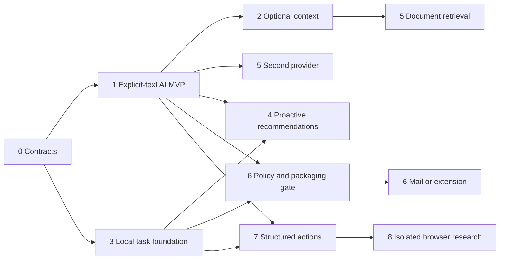

# Implementation roadmap

Research date: 2026-10-21. Planning only; no stage below has been implemented or qualified by this task. The agreed boundaries are recorded in [00](00-executive-summary.md). Scope progression is evidence-driven: a later stage is not a commitment to ship it.

## Release strategy

Release an explicit-text, advisory BYOK assistant first. Follow with optional source context and local productivity features. Treat Gmail/extensions/cloud services and computer use as conditional branches, not prerequisites for useful notch AI. Distribution remains the existing zero-cost ad-hoc GitHub DMG/ZIP policy. Do not silently add a Developer ID/notarization migration or promise a free equivalent.

Complexity labels are relative to this repository: **S** bounded owner/presentation change; **M** new protocol/adapter and tests; **L** multiple new boundaries or native integration qualification; **XL** multi-service/security/operational work. No calendar dates or engineer-week commitments are justified before prototype measurements and known staffing. Vendor verification, hardware access and external review can dominate code-writing time.

## Stage 0 — contracts and qualification plan

**Objective/scope:** make the first slice testable before growing integrations. Define request/events/errors, provider capabilities, privacy/egress receipts, budgets and the invoked AI-surface ownership contract. Specify synthetic fixtures and the exact ad-hoc artifact qualification matrix.

**Prerequisites:** review this blueprint; preserve existing source changes. **Codebase changes later:** add narrow Core contracts and feature flags, two small targets (`NotchiumAI`, `NotchiumAIFeature`), composition injection and mock provider. No general-purpose agent framework.

**Dependencies/complexity:** existing Core/Services/DesignSystem/DynamicIsland; **M**. **Risks:** ambiguous context/approval boundaries, accidentally adding AI to mandatory `allCases` onboarding, feature import cycles.

**Tests/acceptance:** architecture tests prove pure Core and independent feature boundaries; mock stream supports success/refusal/partial/cancel/error; optional AI disabled leaves existing app behavior intact. Record that no live grants/models were qualified. **Independent release:** internal scaffolding only; no user-facing AI claim.

## Stage 1 — first useful AI release

**Objective:** user explicitly supplies text and gets a useful editable/streamed answer in the notch.

**Scope:** Explain/Summarize/Reply intents, conventional configurable registered hotkey and menu fallback, OpenAI direct HTTPS, separate Keychain API credential, provider/egress disclosure, adjustable budgets, Stop/retry/Copy, session-only chat and optional long-work window. No automatic capture or write tools.

**Prerequisites:** Stage0 contracts; a valid developer API account for explicitly authorized manual qualification. **Codebase changes later:** OpenAI adapter and bounded SSE decoder in Services, credential/budget persistence boundaries, AI presentation model/views, renderer contract/keyboard eligibility in shell, root lifecycle wiring and optional AI setup/settings. Reuse explicit Clipboard write without subscribing to history. Keep six-page navigation and geometry.

**Dependencies/complexity:** Foundation/Security/CryptoKit, no external packages/backend; **L**, largely because of lifecycle and packaged credentials. **Risks:** ad-hoc Keychain update prompts, global shortcut collisions, malformed/partial streams, accidental persistence, UI focus regressions and unsupported model/price assumptions.

**Tests/acceptance:** deterministic wire fixtures, concurrent budget reservations, no secret/payload logs, late-stream rejection, focus/Escape/hidden accessibility, companion ownership, real packaged credential save/read/update/cancel on macOS26/current OS. A signed-in developer Mac alone is insufficient. Build/package the actual free profile; existing package/UI/release-safety gates must pass. First launch/relaunch/update behavior is recorded. User can finish AI setup without AX/Screen Recording/Gmail, no external actions are available, and current six pages remain functional. **Independent release:** yes, early access; broad reach is constrained by ad-hoc Gatekeeper friction.

## Stage 2 — optional selected and visual context

**Objective:** remove manual-context friction without continuous collection.

**Scope:** source preview, optional AX selected-text adapter, then separately scoped one-shot screenshot/OCR; manual text remains available. App/window/tab changes invalidate live context. Add explicit selected PDF text/page extraction if the use case requires it, not a full corpus index.

**Prerequisites:** Stage1 egress/cancellation/focus contract. **Codebase changes later:** Services context providers, ContextEngine, optional setup rows/status refresh, source chips and preview, native adapter-local handle lifetimes. Add ScreenCaptureKit/Vision/PDFKit imports only to appropriate adapters.

**Dependencies/complexity:** platform frameworks, real macOS26 test access; **L**. **Risks:** AX timeouts/missing text, screenshot incidental data, OS consent variations, protected content and multi-display scaling. Existing audio/screenshot-folder permission cannot be reused as capture consent.

**Tests/acceptance:** ad-hoc capture/AX spike first; source-scoped single capture with no raw disk writes, stale-generation discard, local OCR uncertainty, denial/revocation cleanup and manual fallback. Qualify Chrome/Safari/Firefox and Preview independently before advertising support. File lock/scan/missing bookmark cases explicit. **Independent release:** yes, each context capability can ship separately if qualification succeeds.

## Stage 3 — local task/source foundation and on-return brief

**Objective:** useful proactive facts without cloud dependency.

**Scope:** selected Calendar projection with durable identity, read-only Reminders inventory, encrypted TaskStore/checkpoints/feedback, local ranking and coalesced launch/return refresh. Show cached freshness/partial coverage; dismissal/snooze are local presentation state. No external completion write initially.

**Prerequisites:** source identity/retention design; does not require Stage2 captures or Anthropic. **Codebase changes later:** narrowly extend Calendar/Reminder adapters, add storage transaction/schema and composition-owned ProductivityRuntime, integrate existing pure Stage25 policies without placing actors/I/O inside that module, add renderer and return triggers. Optional launch-at-login is separate, user-selected new work with packaged registration validation.

**Dependencies/complexity:** EventKit and existing policy/activity/timer structures; **L**. **Risks:** ephemeral Calendar UUID misuse, recurrence/sync resets, completion/dismiss semantics, future-schema data loss and mandatory onboarding expansion.

**Tests/acceptance:** identity reconciliation, civil-day/timezone/DST, repeated wake coalescing, crash-atomic checkpoint/task commits, durable feedback, unavailable source coverage, no cloud calls or overnight power changes. Native permission/Keychain tests and existing Calendar/timer notification regression suites required. **Independent release:** yes, even without AI; add explicit user-requested brief summarization only after source-grounding evaluation.

## Stage 4 — focused proactive recommendations

**Objective:** make the new task inventory useful daily.

**Scope:** intelligent focus suggestions, context quick actions, proposed calendar blocks, next-action ranking, selected-source pre-meeting bundle. Merge resume/conflict/feedback mechanisms into these surfaces; no new top-level pages.

**Prerequisites:** Stage3 for task-based policies; Stage1 for generative quick actions; Stage2 only where capture/doc context is actually needed. **Codebase changes later:** small pure rules/use cases, composition-injected timer intent, source association and existing activity presentation; no duplicated Pomodoro controller or calendar reminder owner.

**Dependencies/complexity:** current policy/timer/Calendar plus TaskStore; **M–L**. **Risks:** duplicate alerts, bad task-duration assumptions, over-interruption and unavailable Focus status mistaken for off.

**Tests/acceptance:** deterministic proposal reasons, gap/buffer constraints, explicit user start, recurring meeting coalescing, quieting/feedback persistence and honest missing-input states. Qualitative usefulness review before expanding notification volume. **Independent release:** yes, candidates can ship separately with their own opt-ins.

## Stage 5 — provider/document expansion

**Objective:** improve coverage only where measured need justifies it.

**Scope:** Anthropic adapter against the same normalized request contract; explicit provider selection with no silent egress fallback. For study/research users, bounded local PDF retrieval, page citations and optional practice questions. Optional saved artifacts remain explicit.

**Prerequisites:** stable Stage1 contract, Stage2 file path for documents. **Codebase changes later:** Claude wire/error/capability adapter, synthetic fixtures, retrieval/index schema if needed, encrypted index/deletion and document revision tracking.

**Dependencies/complexity:** direct provider API; system PDFKit/Vision, optional system SQLite/FTS after ADR; **L**. **Risks:** provider-feature mismatches, long-context costs, inaccurate citations/questions and sensitive derived index retention.

**Tests/acceptance:** both providers pass common refusal/stream/cancel/budget tests; selected model support/prices reverified; retrieval corpus measures relevant passage recall and unsupported claims; page/source links resolve after revision or fail clearly. **Independent release:** yes; second provider and retrieval are separate optional subreleases, not coupled work.

## Stage 6 — conditional mail and browser integration

**Objective:** reliable thread context and supported composer binding where justified.

**Scope:** Gmail incremental sync/thread analysis and/or Chrome-specific extension; server-side threaded drafts and live insertion are distinct later actions. Safari/Firefox get independent adapters/qualification. This is not a promise that the zero-cost constraint permits all integrations.

**Prerequisites:** explicit policy/cost decision after Google's verification/assessment applicability is known; Stage1–3 evidence and state contracts; approved release-inventory changes before any native bridge. **Codebase changes later:** native-app OAuth/token storage, mail source adapter/aliases/checkpoints, extension/bridge protocol and target binding; update notices/privacy/release validator only in that implementation stage.

**Dependencies/complexity:** Google APIs/OAuth/possible assessment, browser stores/host setup; **XL**. **Risks:** paid review requirements, scope breadth, Google data-transfer policy, ad-hoc bridge identity, DOM drift, wrong account/thread and stale editor overwrite.

**Tests/acceptance:** no unread-equals-unanswered, separate awaiting-reply/awaiting-other states, cursor expiry recovery, draft header/thread correctness, nonempty editor protection, account/tab binding and no-send tool policy. If policy/packaging cost gates cannot be met, retain manual text/Copy and mark this stage deferred. **Independent release:** only after all gates; selection/drafting remains useful without it.

## Stage 7 — approved structured actions

**Objective:** one verified external outcome from an explicit request.

**Scope:** typed allowlisted tool, normalized diff/preview, proposal-bound approval, state revalidation, one reversible write/readback, durable operation receipt/recovery; later bounded chaining. Choose one tool, not an open-ended executor.

**Prerequisites:** Stage1 request policy, source contracts and an explicit destination; Stage3 when acting on tasks. **Codebase changes later:** ToolRegistry, ActionApprovalService, domain-specific executor, encrypted receipts/checkpoints and concrete preview UI.

**Dependencies/complexity:** source/destination API, narrow permissions; **L–XL**. **Risks:** prompt injection, time-of-check/time-of-use drift, repeated writes after timeout and nonexistent rollback.

**Tests/acceptance:** policy fails closed, approval bound to scope/hash/revision, no raw shell, timeout classified unknown and reconciled before retry, successful independent readback, user interruption/cancellation cannot authorize the next step. Adversarial documents cannot widen scope. **Independent release:** yes, per tool and only after audited fixtures/native qualification.

## Stage 8 — conditional browser agent; desktop research only

**Objective:** solve demonstrated API gaps in a contained environment.

**Scope:** allowlisted read-only browser workflow first. General desktop control remains research rather than a scheduled release milestone.

**Prerequisites:** Stage7 policy/checkpoint/verification; separate approved isolation/runtime/funding and distribution design. **Codebase changes later:** browser-session adapter, network/filesystem controls, lifecycle/emergency stop and updated executable inventory. A bundled runtime is not permitted by today's verifier without deliberate review.

**Dependencies/complexity:** browser engine/automation framework or hosted environment, provider computer-use API; **XL**. **Risks:** credentials/exfiltration, prompt injection, anti-bot failures, environment escape, operational costs and user desktop interference.

**Tests/acceptance:** isolation and egress tests, per-step validated calls including provider batches, no access to user's normal browser profile/files, bounded cost/steps, fresh observation/postcondition checks and correct unknown/partial outcomes. Desktop expansion requires a new per-app qualification gate and cannot be justified by browser success. **Independent release:** browser experiment only if gates pass; unrestricted desktop agent is not committed.

## Parallel work and critical dependencies

Provider transport/mocks, compact UI and optional-setup work can proceed in parallel **after** Core contracts and session ownership settle. Read-only local task research can proceed alongside explicit-text AI; it does not depend on screenshots. Gmail policy discovery can start early without implementing OAuth or claiming release eligibility. Mutating executor work must follow approval/recovery contracts. Browser/desktop work cannot bypass the action milestone. These are development opportunities, not authorization to spawn parallel implementation or edit production now.

## Essential release scope and deliberate exclusions

Essential first AI release is Stage1 plus its Stage0 foundation/qualification. Optional early enhancements are explicit saved answers and a companion window when needed for usability; both must preserve session-only defaults. Screen context, document retrieval, second provider and local briefings are independent follow-ons.

Do not build first: guaranteed overnight wake, root helpers, managed account/billing service, mail scanning, browser extension, autonomous insertion/send, general desktop/shell actions, passive browsing history, automatic source uploads, full-text indexing of the user's disk, remote vector infrastructure, project-management replacement, or personalized training pipelines. The smallest next concrete development stage is Stage0/1's mock-to-OpenAI vertical slice; shipping proactive breadth before request/privacy/lifecycle quality would multiply uncertainty.
